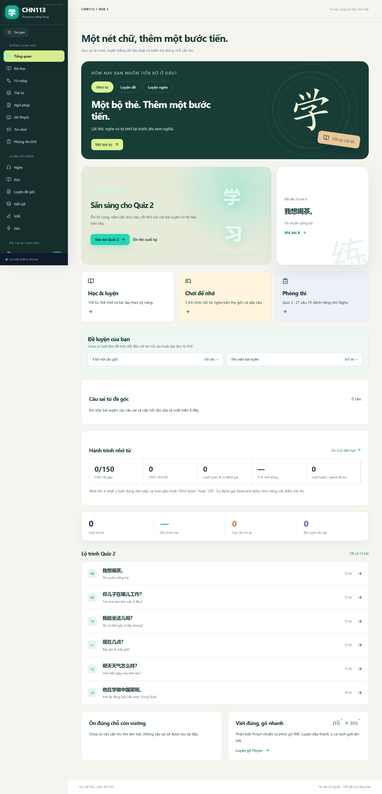

# CHN113 Study V7

[Mở website](https://ducvuongduy5-sketch.github.io/chn113-study/)

Ôn tiếng Trung với 150 từ HSK 1 (HSK 2.0), thẻ từ, 11 game, bài nghe gốc và luyện đề có chữa bài.

## Học và chữa bài

- 27 bộ bài, 290 record: 202 mục có khóa luyện tập suy luận; 88 mục dùng bài mẫu/rubric và tự đối chiếu.
- Đáp án luyện tập không phải khóa thi chính thức. Nguồn mơ hồ được ghi rõ; không có điểm ngữ nghĩa/phát âm giả.
- Quiz 2: 27 vị trí (12 trắc nghiệm + 5 nối + 10 viết), hai bộ sưu tập nguồn và một bộ bổ sung. Không nhận là các mã đề chính thức đã xác minh.
- FE chỉ luyện nghe; 164 mục audio dùng 156 MP3 khác nhau. Tiến độ lưu trên trình duyệt; không đồng bộ tài khoản.
- Speaking có tranh, câu mẫu, Pinyin, nghĩa, ghi âm và phát lại. Micro cần quyền trình duyệt.

## Chạy source

Node.js 22+, `npm ci`, `npm run dev`; mở URL Vite in ra và đường dẫn `/chn113-study/`.
`npm run typecheck`, `npm test`, `npm run build` tạo thư mục `docs/`; `npm run preview` kiểm tra bản build.
React + TypeScript + Vite, HashRouter cho GitHub Pages. `src/` chứa UI/dữ liệu, `public/` chứa media cần chạy, `docs/` là website đã build, `reports/` ghi bằng chứng QA.

TTS phụ thuộc giọng tiếng Trung của thiết bị/trình duyệt; bài nghe FE dùng MP3 thật. Không cần API key hoặc backend. Media tải khi cần, không tải toàn bộ 320 MB khi vào trang.

## Xuất bản

Ngày 03/11/2026. GitHub Pages được chọn vì tài khoản GitHub đã cấp quyền; không cần đăng nhập nền tảng khác. Dùng main → /docs, HTTPS và route dạng `#/games` hỗ trợ refresh.
Người cung cấp học liệu đã xác nhận quyền chia sẻ công khai. PDF/PPTX gốc và dữ liệu trích xuất trung gian không nằm trong repository. Tài liệu CHN113/HSK, ảnh nguồn Studocu/FUOverflow giữ tên và trang nguồn trong dữ liệu. Giao diện/game tự triển khai, có tham khảo cách tổ chức game ngôn ngữ Baolingo; không liên kết với các đơn vị nguồn. Không cấp giấy phép tái sử dụng riêng cho học liệu bên thứ ba.

Xem [QA](reports/FINAL_QA_REPORT.md), [lỗi đã sửa](reports/FINAL_BUG_AUDIT.md), [audio](reports/AUDIO_MAPPING_VERIFIED.md).
